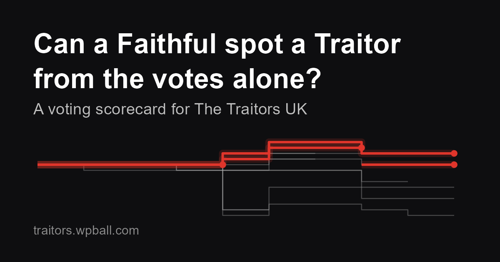

# Can a Faithful spot a Traitor from the votes alone?

**Read the post: [traitors.wpball.com](https://traitors.wpball.com)**



Before she went into the castle for series 2 of *The Celebrity Traitors*, Hannah Fry suggested in a [YouTube video](https://youtu.be/twDvxNooI_4) that a Faithful could keep a running score of who votes like a Traitor. She was recruited as a Traitor before she could try it, so this project tests it on every round table vote in the UK series so far: four regular series and two celebrity series.

The code scrapes Wikipedia's voting tables and turns them into one row per vote. It then works out which voting habits are more typical of Traitors than of Faithfuls, and checks whether a running score built from those habits picks out the Traitors better than chance, or better than the round table itself.

## What I found

- Round tables are better than chance at catching Traitors, but not by a wide margin.
- Traitors and Faithfuls vote differently in small but consistent ways. The strongest signals clear Faithfuls rather than expose Traitors.
- The running score picks out a Traitor far more often than chance or the round table, but only once the first Traitor has been revealed.

The post has the numbers, the plots and the caveats.

## What's in this repository

| File | What it does |
|---|---|
| `index.qmd` | The blog post: scrapes the data, builds the scorecard, tests it and draws the plots |
| `traitors_wikipedia_votes.qmd` | My longer working file, with extra analysis that didn't make the post (murders, recruits, a "looking back" scorecard) |
| `make_header.R` | Makes the banner (`header.png`) and the link-preview image (`share.png`) |
| `_quarto.yaml` | Website settings: publishing to `docs/`, link previews, the GitHub links |
| `docs/` | The rendered website, published with GitHub Pages at traitors.wpball.com |

## Reproducing it

You need R and [Quarto](https://quarto.org). Install the packages once:

```r
install.packages(c("tidyverse", "rvest", "httr2", "knitr", "ggrepel"))
```

Then, from the project folder:

```r
source("make_header.R")   # makes header.png and share.png
```

```bash
quarto render             # builds the post into docs/
```

Both steps download the voting tables from Wikipedia each time they run, waiting a second between pages. Wikipedia pages can be edited, so your numbers could differ slightly from the published post if a table has changed since.

### Adding a new series

Add the page to `pages`, the Traitors (with the episode any recruits switched sides) to `traitors`, and any double votes to `double_votes`. All three lists are near the top of the data chunk in `index.qmd`. Then render. The post checks itself by recounting every round table and comparing the result with Wikipedia's published tally, so a mismatch count above zero means something needs a look.

## Data and checks

- **Source:** the voting tables on each series' Wikipedia page ([CC BY-SA 4.0](https://creativecommons.org/licenses/by-sa/4.0/)).
- **Recount:** every round table is recounted from the individual votes and matched against Wikipedia's tally.
- **Second source:** the votes were cross-checked against [TraitorBase](https://traitorbase.com), which agreed on every vote that both sources recorded.
- **Kept by hand:** who the Traitors were, when recruits switched sides, and who held a double vote.
- **Left out:** fire-pit and endgame votes, and tie-break revotes.

## Spotted a mistake?

Please [open an issue](https://github.com/will-ball/traitors-voting/issues). Corrections to the data, ideas for new behaviours to score, and other ways to test it are all welcome.

## Licence

The code is released under the [MIT licence](LICENSE). The voting data comes from Wikipedia under CC BY-SA 4.0. *The Traitors* is produced by Studio Lambert for the BBC; this is an independent fan analysis with no connection to the programme.
